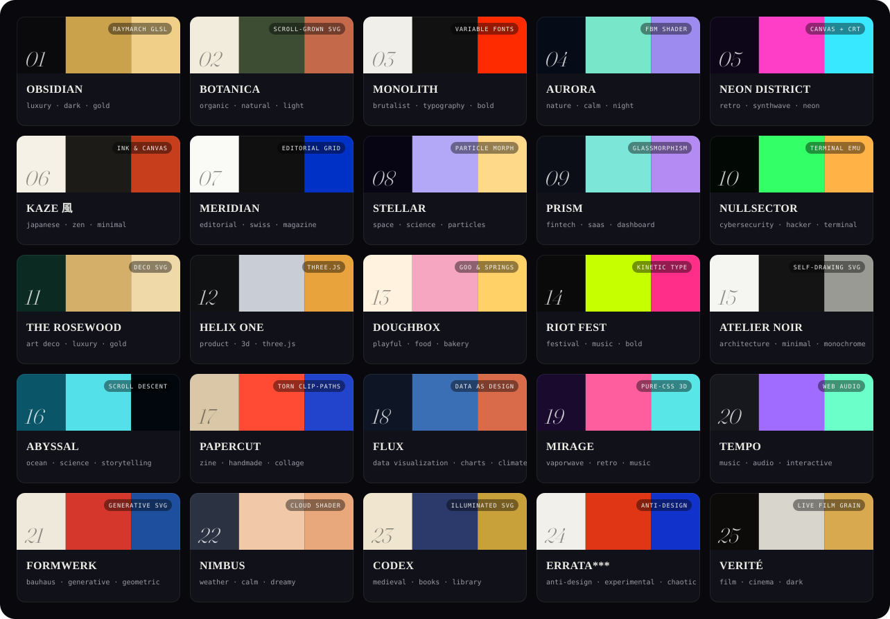

<p align="center">
  
</p>

<p align="center">
  <b>25 complete website styles. Every visual is code. Every word is yours to replace.</b><br>
  Raymarched gold, particle constellations, a playable synthesizer, a Bauhaus poster machine —<br>
  as reusable Astro templates, and as a Claude Code plugin that applies them to any project.
</p>

<p align="center">
  <a href="#quick-start">Quick start</a> ·
  <a href="#the-claude-code-plugin">Claude Code plugin</a> ·
  <a href="#the-styles">The styles</a> ·
  <a href="#how-a-template-works">How it works</a> ·
  <a href="#credits">Credits</a>
</p>

---

## Why Weft

Most templates are a layout with a color swap. Each Weft style is a whole design language: its own
palette, type pairing, motion, and a **signature technique** written in code: WebGL shaders, canvas
simulations, generative SVG, variable fonts, Web Audio.

Each template keeps three things separate:

- **Content** (`content.ts`): every headline, list, price and link, typed and documented.
- **Tokens** (`theme.css`): every color and font stack. Shaders and canvases read them too, so one
  override recolors the whole page, effects included.
- **Craft** (`style.css`, markup, effects): untouched when you make it yours.

## Quick start

```sh
git clone https://github.com/OWNER/weft.git && cd weft
nvm use              # Node 24 (Astro 7 needs ≥ 22.23)
npm install
npm run dev          # http://localhost:4321: the gallery of all 25
```

Make a site from any style:

```sh
npm run new-site -- obsidian acme-watches
```

```ts
// src/sites/acme-watches/site.ts
export const content: Content = { ...demo, /* your copy, typed field by field */ };
export const theme: ThemeOverrides = { '--gold': '#7cc4ff' };   // recolors CSS *and* the shader
export const seo: Partial<Seo> = { title: 'Acme: Watches' };
```

It previews at `/sites/acme-watches/`.

## The Claude Code plugin

The repo is also a Claude Code plugin. Describe the site you want; the `weft` skill suggests three
matching styles and builds with the one you pick.

```
/plugin marketplace add OWNER/weft
/plugin install weft@weft
```

| Mode | What you get |
|---|---|
| **Template** | A complete standalone Astro site in a new folder. Claude fills the content model with your real copy and maps brand colors onto tokens. |
| **Style** | A kit for the project you already have (React, Next, Vue, plain HTML): `tokens.css`, the fonts, and framework-agnostic effect modules. Claude maps them onto your existing components. |

Try:

- *"Build a landing page for a natural-wine bar."*
- *"Restyle this dashboard like prism."*
- `/weft:weft list`

The skill's helper also runs on its own:

```sh
node skills/weft/scripts/weft.mjs deal "climate nonprofit annual report"   # → flux, abyssal
node skills/weft/scripts/weft.mjs template flux  --out ../climate-report
node skills/weft/scripts/weft.mjs style    aurora --out ../my-app/src/styles/weft-aurora
```

## The styles

<p align="center">
  
</p>

<details>
<summary><b>All 25, with techniques and best uses</b></summary>

| # | Style | Technique | Best for |
|---|---|---|---|
| 01 | **OBSIDIAN** `obsidian` | raymarch glsl | luxury goods, watches & jewelry, premium product launches |
| 02 | **BOTANICA** `botanica` | scroll-grown svg | beauty & skincare, perfume, florists, wellness brands |
| 03 | **MONOLITH** `monolith` | variable fonts | type foundries, design studios, developer tools, bold agencies |
| 04 | **AURORA** `aurora` | fbm shader | hotels & retreats, travel, outdoor brands, wellness |
| 05 | **NEON DISTRICT** `arcade` | canvas + crt | bars & nightlife, gaming, events, entertainment |
| 06 | **KAZE 風** `kaze` | ink & canvas | restaurants, tea & coffee, spas, craft studios |
| 07 | **MERIDIAN** `meridian` | editorial grid | magazines, blogs, reports, think tanks |
| 08 | **STELLAR** `stellar` | particle morph | museums & planetariums, science & education, events |
| 09 | **PRISM** `prism` | glassmorphism | fintech, SaaS products, dashboards, startups |
| 10 | **NULLSECTOR** `null` | terminal emu | security firms, developer & CLI tools, hackathons |
| 11 | **THE ROSEWOOD** `rosewood` | deco svg | hotels, restaurants & cocktail bars, weddings & events |
| 12 | **HELIX ONE** `helix` | three.js | hardware launches, audio products, consumer electronics |
| 13 | **DOUGHBOX** `doughbox` | goo & springs | bakeries & cafes, food brands, kids products, playful consumer brands |
| 14 | **RIOT FEST** `riot` | kinetic type | festivals, concerts, events, streetwear |
| 15 | **ATELIER NOIR** `atelier` | self-drawing svg | architects, interior designers, portfolios, galleries |
| 16 | **ABYSSAL** `abyssal` | scroll descent | research institutes, nonprofits & conservation, long-form storytelling |
| 17 | **PAPERCUT** `papercut` | torn clip-paths | indie publishers, print shops, creative studios, craft brands |
| 18 | **FLUX** `flux` | data as design | data stories, research reports, climate & NGOs, annual reports |
| 19 | **MIRAGE** `mirage` | pure-css 3d | record labels, musicians & merch, creative collectives |
| 20 | **TEMPO** `tempo` | web audio | music tech, audio products, interactive demos |
| 21 | **FORMWERK** `formwerk` | generative svg | design schools, art exhibitions, generative tools, studios |
| 22 | **NIMBUS** `nimbus` | cloud shader | wellness & meditation apps, consumer apps, mood products |
| 23 | **CODEX** `codex` | illuminated svg | libraries & bookshops, museums, heritage orgs, publishers |
| 24 | **ERRATA***** `errata` | anti-design | experimental agencies, art projects, personal sites |
| 25 | **VERITÉ** `verite` | live film grain | film studios, production companies, photographers, film festivals |
</details>

The gallery (`gallery`) and the long-form article (`guide`) are templates too.

## How a template works

Each style lives in `src/templates/<slug>/`. Need a knob a style lacks? Add an optional `Content`
field whose default keeps the original look.

Adding a style takes four steps: create the folder, add `tags`/`bestFor` to its `meta.ts`, add a
route at `src/pages/NN-<slug>/`, and run `npm run build:skill` to refresh the plugin's references.
The in-site guide at `/guide/` walks through the rest.

## Scripts

| Command | |
|---|---|
| `npm run dev` / `build` / `preview` | Astro dev server, static build to `dist/`, preview |
| `npm run check` | type-check `.astro` + `.ts` |
| `npm run new-site -- <style> <name>` | scaffold a site inside this repo |
| `npm run build:skill` | regenerate the plugin's style references from the templates |

## Credits

The 25 original designs come from the [showcase](https://fable-showcase-25.netlify.app/) by
**[BrainwavePro](https://github.com/BrainwavePro)** (The Legendary Bobby).
Weft rebuilds them as reusable, themeable templates and a Claude Code plugin. All brands in the demos
are fictional.

Built with [Astro](https://astro.build) and [three.js](https://threejs.org). Fonts from Google Fonts.

## License

[MIT](LICENSE). This covers the Weft code. Credit for the original designs goes to their author.
